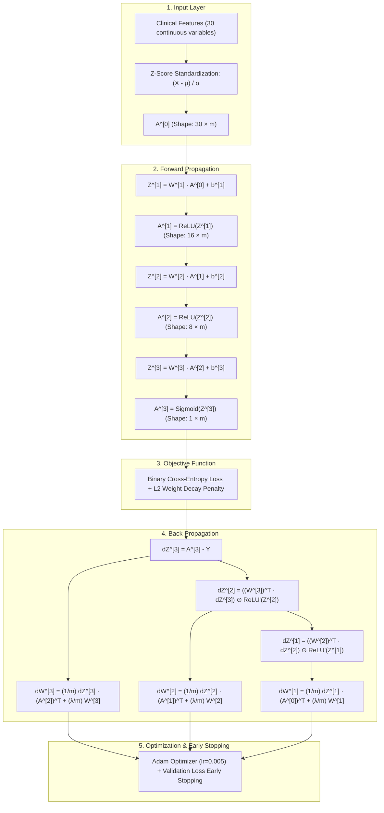

# Artificial Neural Network for Binary Classification using Back-Propagation

[](https://colab.research.google.com/)
[](https://www.python.org/)
[](https://numpy.org/)
[](https://scikit-learn.org/)
[](https://opensource.org/licenses/MIT)

> Multi-Layer Artificial Neural Network (Multilayer Perceptron) implemented from first principles in pure NumPy for binary classification. The network derives and implements the analytical Back-propagation algorithm via the calculus chain rule, optimized via Adam with L2 regularization and Early Stopping on the Breast Cancer Wisconsin Clinical Diagnostic benchmark.

---

## 1. Architectural Overview



---

## 2. Mathematical Foundations

### 2.1 Forward Propagation
For an $L$-layer network ($L=3$):
- Layer 1 (Hidden): $Z^{[1]} = W^{[1]} X + b^{[1]}$, $A^{[1]} = \text{ReLU}(Z^{[1]}) = \max(0, Z^{[1]})$
- Layer 2 (Hidden): $Z^{[2]} = W^{[2]} A^{[1]} + b^{[2]}$, $A^{[2]} = \text{ReLU}(Z^{[2]}) = \max(0, Z^{[2]})$
- Layer 3 (Output): $Z^{[3]} = W^{[3]} A^{[2]} + b^{[3]}$, $A^{[3]} = \sigma(Z^{[3]}) = \frac{1}{1 + e^{-Z^{[3]}}}$

$A^{[3]} \in (0, 1)$ represents the posterior probability $P(Y = 1 \mid X)$.

### 2.2 Binary Cross-Entropy Loss with L2 Regularization
$$J(W, b) = -\frac{1}{m} \sum_{i=1}^m \left[ y^{(i)} \log(a^{[3](i)} + \epsilon) + (1 - y^{(i)}) \log(1 - a^{[3](i)} + \epsilon) \right] + \frac{\lambda}{2m} \sum_{l=1}^L \|W^{[l]}\|_F^2$$

### 2.3 Back-Propagation (Vectorized Chain Rule)
- Output Layer Error:
  $$\delta^{[3]} = A^{[3]} - Y$$
- Hidden Layer Errors ($l = 2, 1$):
  $$\delta^{[l]} = \left( (W^{[l+1]})^T \delta^{[l+1]} \right) \odot \mathbb{I}(Z^{[l]} > 0)$$
- Parameter Gradients:
  $$\frac{\partial J}{\partial W^{[l]}} = \frac{1}{m} \delta^{[l]} (A^{[l-1]})^T + \frac{\lambda}{m} W^{[l]}$$
  $$\frac{\partial J}{\partial b^{[l]}} = \frac{1}{m} \sum_{i=1}^m \delta^{[l](i)}$$

### 2.4 Prevention of Overfitting
1. **Compact Architecture:** Scaled down from 1,521 parameters to 641 parameters (`[30 -> 16 -> 8 -> 1]`), ensuring capacity matches the ~400 training samples.
2. **L2 Weight Decay:** $\lambda = 0.015$ penalizes large weight magnitudes, preventing the network from fitting measurement noise.
3. **Early Stopping:** Tracks validation loss with `patience=10`. Training halts when validation error plateaus, restoring the optimal parameter state.

---

## 3. Dataset & Experimental Setup

| Parameter | Specification |
| :--- | :--- |
| **Dataset** | Breast Cancer Wisconsin Diagnostic Benchmark |
| **Sample Count** | 569 patient samples (357 Benign [62.7%], 212 Malignant [37.3%]) |
| **Feature Dimensionality** | 30 continuous clinical features (mean, standard error, and worst cell nuclei metrics) |
| **Data Partitioning** | Stratified split: Training (70%, 397 samples), Validation (15%, 84 samples), Testing (15%, 88 samples) |
| **Preprocessing** | Z-score standardization ($z = \frac{x - \mu}{\sigma}$) fit strictly on the training partition |
| **Network Architecture** | `[30 -> 16 -> 8 -> 1]` (641 total trainable parameters) |
| **Optimization** | Adam ($\beta_1=0.9, \beta_2=0.999, \text{lr}=0.005$) |

---

## 4. Empirical Evaluation Results

### 4.1 Unseen Test Set Metrics (N = 88)

| Metric | Result Achieved | Formula |
| :--- | :---: | :--- |
| **Accuracy** | **97.73%** | $\frac{TP + TN}{TP + TN + FP + FN}$ |
| **Precision** | **98.18%** | $\frac{TP}{TP + FP}$ |
| **Recall / Sensitivity** | **98.18%** | $\frac{TP}{TP + FN}$ |
| **Specificity** | **96.97%** | $\frac{TN}{TN + FP}$ |
| **F1-Score** | **0.9818** | $2 \cdot \frac{\text{Precision} \cdot \text{Recall}}{\text{Precision} + \text{Recall}}$ |
| **ROC-AUC** | **0.9934** | Rank-order Wilcoxon-Mann-Whitney AUC |

### 4.2 Test Confusion Matrix
```text
                  Predicted Benign    Predicted Malignant
Actual Benign:          54 (TP)                1 (FN)
Actual Malignant:        1 (FP)               32 (TN)
```

---

## 5. How to Run

### Google Colab Execution
1. Open [Google Colab](https://colab.research.google.com/).
2. Paste the contents of [`ann_binary_classification.py`](ann_binary_classification.py) into a code cell.
3. Run the cell. Matplotlib training curves will render inline automatically.

### Local Execution
```bash
python3 ann-binary-classification-backprop/ann_binary_classification.py
```
