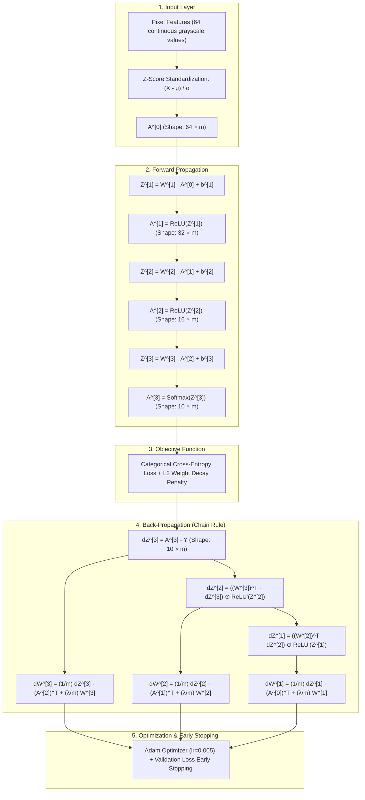
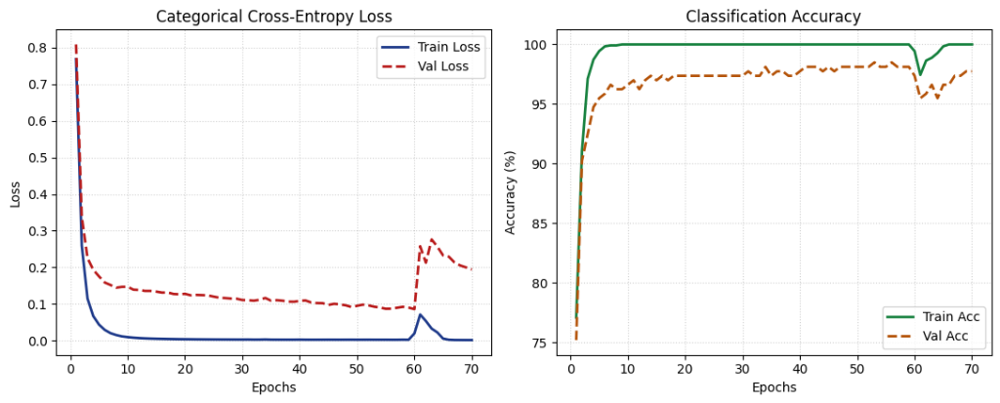

# Artificial Neural Network for Multi-Class Classification using Back-Propagation

[](https://colab.research.google.com/)
[](https://www.python.org/)
[](https://numpy.org/)
[](https://scikit-learn.org/)
[](https://opensource.org/licenses/MIT)

> Multi-Layer Artificial Neural Network (Multilayer Perceptron) implemented from first principles in pure NumPy for multi-class classification. The network derives and implements the analytical Back-propagation algorithm via the calculus chain rule for Softmax output and Categorical Cross-Entropy, optimized via Adam with L2 regularization and Early Stopping on the Optical Recognition of Handwritten Digits benchmark (10 classes).

---

## 1. Architectural Overview



---

## 2. Mathematical Foundations

### 2.1 Forward Propagation
For an $L$-layer network ($L=3$) with $K=10$ output classes:
- Hidden Layer 1: $Z^{[1]} = W^{[1]} X + b^{[1]}$, $A^{[1]} = \text{ReLU}(Z^{[1]}) = \max(0, Z^{[1]})$
- Hidden Layer 2: $Z^{[2]} = W^{[2]} A^{[1]} + b^{[2]}$, $A^{[2]} = \text{ReLU}(Z^{[2]}) = \max(0, Z^{[2]})$
- Output Layer: $Z^{[3]} = W^{[3]} A^{[2]} + b^{[3]}$, $A^{[3]} = \text{Softmax}(Z^{[3]})$

For sample $i$ and class $k \in \{1, \dots, K\}$:
$$A_{k, i}^{[3]} = \frac{e^{Z_{k, i}^{[3]} - \max_j Z_{j, i}^{[3]}}}{\sum_{c=1}^K e^{Z_{c, i}^{[3]} - \max_j Z_{j, i}^{[3]}}}$$

$A_{k, i}^{[3]}$ represents the posterior probability $P(Y = k \mid X_i)$, where $\sum_{k=1}^K A_{k, i}^{[3]} = 1.0$.

### 2.2 Categorical Cross-Entropy Loss with L2 Regularization
$$J(W, b) = -\frac{1}{m} \sum_{i=1}^m \sum_{k=1}^K Y_{k, i} \log(A_{k, i}^{[3]} + \epsilon) + \frac{\lambda}{2m} \sum_{l=1}^L \|W^{[l]}\|_F^2$$
where $Y \in \{0, 1\}^{K \times m}$ is the one-hot target matrix and $\epsilon = 10^{-15}$.

### 2.3 Back-Propagation (Vectorized Chain Rule)
- Derivative with respect to output logits ($Z^{[3]}$):
  Using the Jacobian of Softmax $\frac{\partial A_k}{\partial Z_j} = A_k (\delta_{kj} - A_j)$:
  $$\frac{\partial J}{\partial Z_j^{[3]}} = -\sum_{k=1}^K \frac{Y_k}{A_k} \frac{\partial A_k}{\partial Z_j} = -\sum_{k=1}^K \frac{Y_k}{A_k} A_k (\delta_{kj} - A_j) = -Y_j + A_j \sum_{k=1}^K Y_k = A_j^{[3]} - Y_j$$
  $$\delta^{[3]} = A^{[3]} - Y$$
- Hidden Layer Errors ($l = 2, 1$):
  $$\delta^{[l]} = \left( (W^{[l+1]})^T \delta^{[l+1]} \right) \odot \mathbb{I}(Z^{[l]} > 0)$$
- Parameter Gradients:
  $$\frac{\partial J}{\partial W^{[l]}} = \frac{1}{m} \delta^{[l]} (A^{[l-1]})^T + \frac{\lambda}{m} W^{[l]}$$
  $$\frac{\partial J}{\partial b^{[l]}} = \frac{1}{m} \sum_{i=1}^m \delta^{[l](i)}$$

### 2.4 Prevention of Overfitting
1. **Appropriate Parameter Proportion:** Model capacity ($2,778$ parameters across `[64 -> 32 -> 16 -> 10]`) matches the $1,252$ training samples.
2. **L2 Weight Decay:** $\lambda = 0.01$ prevents individual weight magnitudes from exploding.
3. **Early Stopping:** Tracks validation categorical cross-entropy loss with `patience=10`, automatically restoring the optimal parameter state.

---

## 3. Dataset & Experimental Setup

| Parameter | Specification |
| :--- | :--- |
| **Dataset** | Optical Recognition of Handwritten Digits |
| **Sample Count** | 1,797 samples ($8 \times 8$ pixel grayscale images) |
| **Feature Dimensionality** | 64 continuous input features (normalized pixel intensities) |
| **Number of Classes** | 10 balanced digit classes ($0$ through $9$) |
| **Data Partitioning** | Stratified split: Training (70%, 1,252 samples), Validation (15%, 264 samples), Testing (15%, 281 samples) |
| **Preprocessing** | Z-score standardization ($z = \frac{x - \mu}{\sigma}$) fit strictly on the training partition |
| **Network Architecture** | `[64 -> 32 -> 16 -> 10]` (ReLU hidden activations, Softmax output) |
| **Optimization** | Adam ($\beta_1=0.9, \beta_2=0.999, \text{lr}=0.005$) |

---

## 4. Empirical Evaluation Results

### 4.1 Training Dynamics & Loss Trajectory



- **Initial Convergence (Epochs 1-10)**: Fast exponential descent in categorical cross-entropy loss from 0.7686 to 0.0093, with validation accuracy reaching 96.62%.
- **Validation Refinement (Epochs 11-60)**: Validation loss reached its optimal minimum of 0.0859 at epoch 60 with 98.12% validation accuracy.
- **Early Stopping & Model Checkpointing**: When validation loss plateaued and diverged past epoch 60, early stopping triggered at epoch 70, restoring the optimal model weights from epoch 60 and safeguarding against overfitting.

### 4.2 Unseen Test Set Metrics (N = 279)

| Metric | Result Achieved | Formula |
| :--- | :---: | :--- |
| **Overall Accuracy** | **95.70%** | $\frac{\sum \mathbb{I}(\hat{y} = y)}{N}$ |
| **Macro Precision** | **95.86%** | $\frac{1}{K} \sum_{k=1}^K \text{Precision}_k$ |
| **Macro Recall** | **95.65%** | $\frac{1}{K} \sum_{k=1}^K \text{Recall}_k$ |
| **Macro F1-Score** | **0.9561** | $\frac{1}{K} \sum_{k=1}^K \text{F1}_k$ |

### 4.3 Test Confusion Matrix ($10 \times 10$)
```text
Rows: Actual Digit, Columns: Predicted Digit (N = 279)
     [0] [1] [2] [3] [4] [5] [6] [7] [8] [9]
[0]   28   0   0   0   0   0   0   0   0   0
[1]    0  25   1   0   1   1   0   0   0   0
[2]    0   0  28   0   0   0   0   0   0   0
[3]    0   0   0  28   0   0   0   0   0   0
[4]    0   0   0   0  27   0   0   0   0   1
[5]    0   0   0   0   0  28   0   0   0   0
[6]    0   0   0   0   0   0  28   0   0   0
[7]    0   0   0   0   0   0   0  28   0   0
[8]    0   2   0   1   0   1   0   1  22   0
[9]    0   2   0   0   0   0   0   1   0  25
```

---

## 5. How to Run

### Google Colab Execution
1. Open [Google Colab](https://colab.research.google.com/).
2. Paste the contents of [`ann_multiclass_classification.py`](ann_multiclass_classification.py) into a code cell.
3. Run the cell. Matplotlib training and loss curves will render inline automatically.

### Local Execution
```bash
python3 ann-multiclass-classification-backprop/ann_multiclass_classification.py
```
