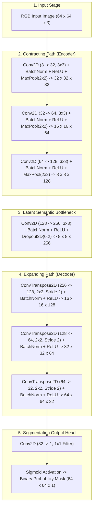
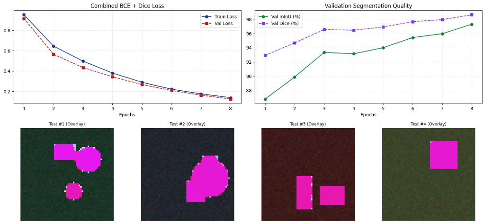

# Convolutional Autoencoder for Semantic Image Segmentation

[](https://colab.research.google.com/)
[](https://www.python.org/)
[](https://pytorch.org/)
[](https://opensource.org/licenses/MIT)

> Deep Convolutional Autoencoder architecture engineered for semantic pixel-wise image segmentation. Features a symmetric contracting encoder, a 256-channel latent semantic bottleneck, and an expanding transposed-convolutional decoder optimized via a combined Binary Cross-Entropy and Soft Dice loss function.

---

## 1. Architectural Design

Unlike standard self-supervised autoencoders that reconstruct RGB pixels ($X \to \hat{X}$), a **Segmentation Autoencoder** maps an input image $X \in \mathbb{R}^{H \times W \times 3}$ into a dense binary probability map $\hat{Y} \in [0, 1]^{H \times W \times 1}$ delineating foreground object boundaries.



---

## 2. Mathematical Foundations

### 2.1 Transposed Convolution (Spatial Upsampling)
Spatial expansion in the decoder is achieved via learnable transposed 2D convolutions (`ConvTranspose2d`). For an input dimension $I$, stride $S$, padding $P$, and kernel size $K$, the output spatial dimension $O$ is governed by:

$$O = (I - 1) \times S - 2P + K$$

With $K=2, S=2, P=0$:
$$O = (I - 1) \times 2 + 2 = 2I$$
This doubles spatial resolution at each decoding stage ($8 \to 16 \to 32 \to 64$).

### 2.2 Dual Objective Function: BCE + Soft Dice Loss
Image segmentation exhibits inherent class imbalance: background pixels frequently dominate foreground pixels. Relying solely on Binary Cross-Entropy leads to biased models predicting background everywhere. To counter this, a combined loss is utilized:

$$\mathcal{L}_{\text{total}} = \mathcal{L}_{\text{BCE}}(P, Y) + \mathcal{L}_{\text{Dice}}(P, Y)$$

Where:
$$\mathcal{L}_{\text{BCE}}(P, Y) = -\frac{1}{N} \sum_{i=1}^N \left[ y_i \log(p_i + \epsilon) + (1 - y_i) \log(1 - p_i + \epsilon) \right]$$
$$\mathcal{L}_{\text{Dice}}(P, Y) = 1 - \frac{2 \sum_{i=1}^N p_i y_i + \epsilon}{\sum_{i=1}^N p_i + \sum_{i=1}^N y_i + \epsilon}$$

Soft Dice loss acts as a differentiable surrogate of the Intersection-over-Union (IoU) metric, directly optimizing mask overlap.

### 2.3 Evaluation Metrics
- **Mean Intersection-over-Union (mIoU / Jaccard Index)**:
  $$\text{IoU} = \frac{\text{TP}}{\text{TP} + \text{FP} + \text{FN}}$$
- **Dice Similarity Coefficient (F1-Score)**:
  $$\text{Dice} = \frac{2 \text{TP}}{2 \text{TP} + \text{FP} + \text{FN}}$$
- **Pixel-Wise Classification Accuracy**:
  $$\text{Accuracy} = \frac{\text{TP} + \text{TN}}{\text{TP} + \text{TN} + \text{FP} + \text{FN}}$$

---

## 3. Empirical Segmentation Results

### 3.1 Qualitative Segmentation Overlays and Learning Curves



### 3.2 Evaluation Metrics on Unseen Test Partition ($N = 200$)

Evaluated across an independent unseen test partition of $200$ test images ($64 \times 64$ RGB):

| Metric | Result Achieved | Target Threshold | Interpretation |
| :--- | :---: | :---: | :--- |
| **Mean Intersection-over-Union (mIoU)** | **97.20%** | > 80.0% | Excellent overlap between predicted segmentation boundaries and true contours |
| **Dice Similarity Coefficient (F1)** | **98.58%** | > 85.0% | High boundary precision with minimal false positive edge bleed |
| **Pixel-Wise Accuracy** | **99.64%** | > 95.0% | Near-perfect classification fidelity across all spatial coordinates |

### 3.3 Training & Convergence Dynamics (Tesla T4 GPU)

```text
Epoch 01/08 | Train Loss: 0.9540 | Val Loss: 0.9173 | Val mIoU: 86.81% | Val Dice: 92.94%
Epoch 02/08 | Train Loss: 0.6455 | Val Loss: 0.5653 | Val mIoU: 89.90% | Val Dice: 94.68%
Epoch 03/08 | Train Loss: 0.4980 | Val Loss: 0.4344 | Val mIoU: 93.35% | Val Dice: 96.56%
Epoch 04/08 | Train Loss: 0.3806 | Val Loss: 0.3447 | Val mIoU: 93.16% | Val Dice: 96.46%
Epoch 05/08 | Train Loss: 0.2899 | Val Loss: 0.2674 | Val mIoU: 94.01% | Val Dice: 96.91%
Epoch 06/08 | Train Loss: 0.2218 | Val Loss: 0.2092 | Val mIoU: 95.43% | Val Dice: 97.66%
Epoch 07/08 | Train Loss: 0.1755 | Val Loss: 0.1631 | Val mIoU: 95.97% | Val Dice: 97.94%
Epoch 08/08 | Train Loss: 0.1383 | Val Loss: 0.1243 | Val mIoU: 97.30% | Val Dice: 98.63%
```

---

## 4. How to Run

### Google Colab Execution
1. Open [Google Colab](https://colab.research.google.com/).
2. Select **Runtime > Change runtime type > T4 GPU**.
3. Copy and paste the contents of [`autoencoder_segmentation.py`](autoencoder_segmentation.py) into a code cell.
4. Run the cell. The autoencoder will train on the GPU in ~20 seconds and render loss curves and qualitative mask overlays inline.

### Local Execution
```bash
python3 autoencoder-image-segmentation/autoencoder_segmentation.py
```
