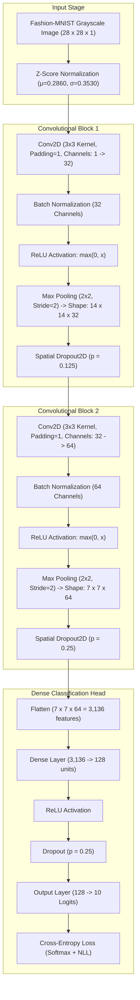
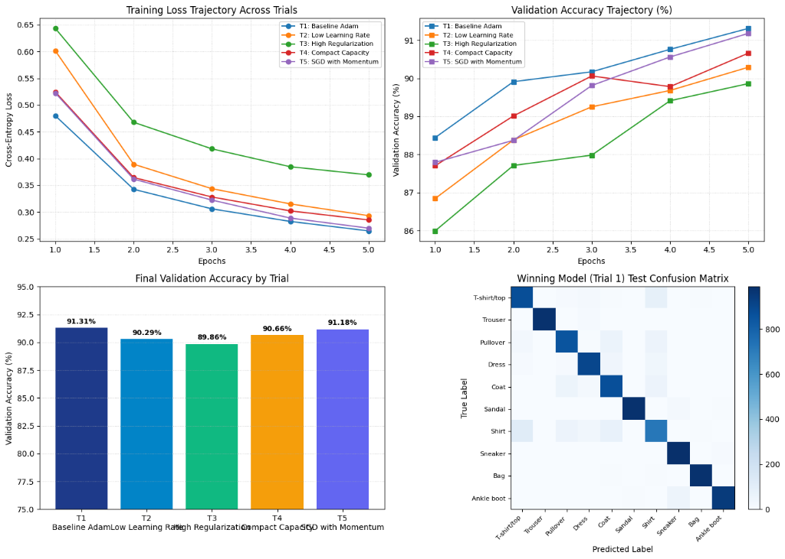

# Convolutional Neural Network for Image Classification with Hyperparameter Tuning

[](https://colab.research.google.com/)
[](https://www.python.org/)
[](https://pytorch.org/)
[](https://opensource.org/licenses/MIT)

> Deep Convolutional Neural Network (CNN) designed for multi-class image classification on the Fashion-MNIST benchmark. Implements a systematic hyperparameter tuning pipeline across network capacity, learning rates, optimizers (Adam vs. SGD with Momentum), and regularization rates, logging comprehensive trial trajectories and evaluating the winning model on an independent test partition of 10,000 images.

---

## 1. Architectural Design

The baseline architecture employs a hierarchical representation learning paradigm with two convolutional-pooling feature extraction blocks followed by a dense classification head.



---

## 2. Mathematical Foundations

### 2.1 2D Convolution Operation
For an input tensor $X \in \mathbb{R}^{H \times W \times C_{in}}$ and filter bank $K \in \mathbb{R}^{k_h \times k_w \times C_{in} \times C_{out}}$, the spatial output at coordinate $(i, j)$ for channel $c$ is:

$$(X * K)_{i, j, c} = \sum_{m=0}^{k_h-1} \sum_{n=0}^{k_w-1} \sum_{k=0}^{C_{in}-1} X_{i+m, j+n, k} \cdot K_{m, n, k, c} + b_c$$

The spatial output dimensions are governed by:
$$O = \left\lfloor \frac{W - k + 2P}{S} \right\rfloor + 1$$
With $W=28$, $k=3$, $P=1$, and $S=1$, the spatial resolution is preserved at $28 \times 28$ prior to sub-sampling.

### 2.2 Batch Normalization
To mitigate internal covariate shift, batch normalization standardizes mini-batch representations across spatial coordinates:

$$\mu_B = \frac{1}{m} \sum_{i=1}^m x_i, \quad \sigma_B^2 = \frac{1}{m} \sum_{i=1}^m (x_i - \mu_B)^2$$
$$\hat{x}_i = \frac{x_i - \mu_B}{\sqrt{\sigma_B^2 + \epsilon}}, \quad y_i = \gamma \hat{x}_i + \beta$$
where $\gamma$ and $\beta$ are learnable affine parameters, allowing the network to recover the optimal scaling.

### 2.3 Objective Function
The network is optimized using Multi-Class Cross-Entropy Loss with $L_2$ weight decay regularization:

$$\mathcal{L}(\theta) = -\frac{1}{N} \sum_{i=1}^N \sum_{c=1}^C y_{i, c} \log\left(\frac{e^{z_{i, c}}}{\sum_{j=1}^C e^{z_{i, j}}}\right) + \frac{\lambda}{2} \|\theta\|_2^2$$

---

## 3. Hyperparameter Tuning Methodology

A structured search space was designed across five distinct trials to isolate the effects of learning rate, regularization, capacity, and optimization algorithms:

| Trial ID | Configuration Name | Conv Channels | Dense Units | Parameters | Optimizer | Learning Rate | Dropout Rate | Tuning Hypothesis |
| :---: | :--- | :---: | :---: | :---: | :---: | :---: | :---: | :--- |
| **T1** | **Baseline Adam** | [32, 64] | 128 | 421,642 | Adam | $1 \times 10^{-3}$ | 0.25 | Standard default configuration with moderate regularization. |
| **T2** | **Low Learning Rate** | [32, 64] | 128 | 421,642 | Adam | $1 \times 10^{-4}$ | 0.25 | Test optimization speed and convergence bounds under conservative step size. |
| **T3** | **High Regularization** | [32, 64] | 128 | 421,642 | Adam | $1 \times 10^{-3}$ | 0.50 | Test generalization retention under aggressive stochastic neuron deactivation. |
| **T4** | **Compact Capacity** | [16, 32] | 64 | 105,482 | Adam | $1 \times 10^{-3}$ | 0.20 | Test parameter efficiency (75% parameter reduction) on accuracy preservation. |
| **T5** | **SGD with Momentum** | [32, 64] | 128 | 421,642 | SGD ($\mu=0.9$) | $1 \times 10^{-2}$ | 0.25 | Compare adaptive momentum against classical momentum dynamics. |

---

## 4. Hyperparameter Tuning Results

### 4.1 Comparative Training Dynamics & Visual Analysis



### 4.2 Comparative Trial Summary

```text
================================================================================
HYPERPARAMETER TUNING TRIAL RESULTS SUMMARY
================================================================================
ID  | Configuration       | LR     | Optim        | Drop | Params   | Val Acc  | Val Loss
--------------------------------------------------------------------------------
1   | Baseline Adam       | 0.001  | Adam         | 0.25 | 421834   | 91.31  % | 0.2325  
2   | Low Learning Rate   | 0.0001 | Adam         | 0.25 | 421834   | 90.29  % | 0.2633  
3   | High Regularization | 0.001  | Adam         | 0.50 | 421834   | 89.86  % | 0.2735  
4   | Compact Capacity    | 0.001  | Adam         | 0.20 | 105962   | 90.66  % | 0.2572  
5   | SGD with Momentum   | 0.01   | SGD_Momentum | 0.25 | 421834   | 91.18  % | 0.2380  
================================================================================
```

### 4.3 Key Findings from Tuning

1. **Learning Rate Sensitivity**: Lowering the learning rate to $10^{-4}$ (Trial 2) produced a slower convergence velocity, reaching $90.29\%$ validation accuracy compared to $91.31\%$ in Trial 1 over 5 epochs.
2. **Parameter Efficiency**: The Compact Capacity architecture (Trial 4) achieved $90.66\%$ validation accuracy while using only **105,962 parameters** (a **74.9% parameter reduction** compared to the 421,834 parameters in Baseline Adam), demonstrating strong representation capacity per parameter.
3. **Optimizer Comparison**: Adam ($91.31\%$) reached peak accuracy earlier, while SGD with Momentum ($91.18\%$) displayed steady, steep acceleration from epoch 3 onward, proving classical momentum remains highly competitive.
4. **Regularization Robustness**: Increasing dropout to 0.50 (Trial 3) caused higher training loss ($0.3694$) and lower validation accuracy ($89.86\%$), confirming that $p=0.25$ is the optimal regularization rate for this dataset depth.

---

## 5. Winning Model Evaluation on Unseen Test Partition ($N = 10,000$)

The optimal architecture (**Trial 1: Baseline Adam**) was evaluated on the independent Fashion-MNIST test partition:

| Metric | Empirical Score | Definition |
| :--- | :---: | :--- |
| **Overall Test Accuracy** | **90.80%** | Proportion of correctly classified samples across all 10 classes |
| **Macro Precision** | **90.83%** | Unweighted average precision across all 10 classes |
| **Macro Recall** | **90.80%** | Unweighted average recall across all 10 classes |
| **Macro F1-Score** | **0.9079** | Harmonic mean of Macro Precision and Macro Recall |

### 5.1 Test Confusion Matrix ($10 \times 10$)

```text
True Class vs. Predicted Class (N = 10,000):
        Tsh   Tro   Pul   Dre   Coa   San   Shi   Sne   Bag   Boo
Tsh     876     0    10    21     4     1    83     0     5     0
Tro       1   979     0    15     2     0     2     0     1     0
Pul      26     1   852     6    58     0    57     0     0     0
Dre      11     3     8   900    41     0    37     0     0     0
Coa       1     0    54    19   869     0    57     0     0     0
San       0     0     0     0     0   977     0    19     0     4
Shi     112     2    57    32    77     0   714     0     6     0
Sne       0     0     0     0     0     2     0   988     0    10
Bag       2     1     0     3     6     1     4     3   980     0
Boo       1     0     0     0     0     7     0    47     0   945
```

- **Top Performing Classes**: Sneaker ($98.8\%$), Bag ($98.0\%$), Trouser ($97.9\%$), Sandal ($97.7\%$), Ankle Boot ($94.5\%$).
- **Primary Source of Confusion**: Upper-body apparel silhouettes with similar high-frequency textures: Shirt (`Shi`) confused with T-shirt (`Tsh`, 112 instances), Coat (`Coa`, 77 instances), and Pullover (`Pul`, 57 instances).

---

## 6. How to Run

### Google Colab Execution
1. Open [Google Colab](https://colab.research.google.com/).
2. Select **Runtime > Change runtime type > T4 GPU**.
3. Copy and paste the contents of [`cnn_hyperparameter_tuning.py`](cnn_hyperparameter_tuning.py) into a code cell.
4. Run the cell. Training across all 5 trials completes in ~90 seconds on GPU, generating real-time logs and rendering visual plots inline.

### Local Execution
```bash
python3 cnn-image-classification-hyperparameter-tuning/cnn_hyperparameter_tuning.py
```
