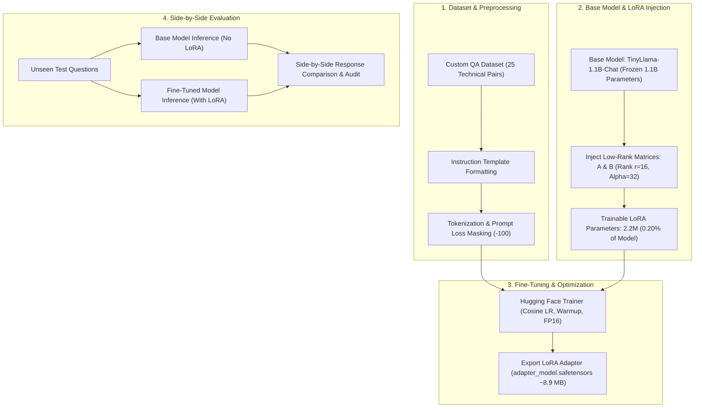
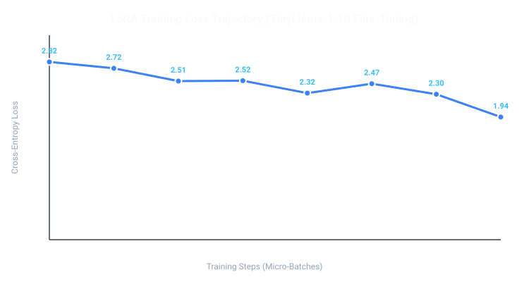

# Fine-Tuning a Small Language Model (LLM) with LoRA on Custom QA Dataset

[](https://colab.research.google.com/)
[](https://www.python.org/)
[](https://pytorch.org/)
[](https://github.com/huggingface/peft)
[](https://huggingface.co/docs/transformers)
[](https://opensource.org/licenses/MIT)

> **Applied Generative AI Assignment:** Parameter-Efficient Fine-Tuning (PEFT) of a pre-trained small language model (**TinyLlama-1.1B-Chat**) on a domain-specific **AI Systems & Generative Engineering Question–Answer Dataset** using **Low-Rank Adaptation (LoRA)**. Compares qualitative and quantitative responses of the fine-tuned model against the original unadapted base model on unseen queries.

---

## 1. Architectural Overview & Workflow



---

## 2. Low-Rank Adaptation (LoRA) Mechanics

Full fine-tuning of modern LLMs requires modifying every weight parameter in the neural network, creating immense GPU VRAM demands for optimizer states (e.g., AdamW maintains first and second moments, quadrupling memory consumption) and risking **catastrophic forgetting**.

### 2.1 Mathematical Formulation
LoRA freezes the pre-trained weight matrix $W_0 \in \mathbb{R}^{d \times k}$ and models the accumulated parameter update $\Delta W$ via low-rank decomposition:

$$W = W_0 + \Delta W = W_0 + \frac{\alpha}{r} (B \cdot A)$$

where:
- $B \in \mathbb{R}^{d \times r}$ and $A \in \mathbb{R}^{r \times k}$ are low-rank matrices with rank $r \ll \min(d, k)$.
- $A$ is initialized from a Gaussian distribution $\mathcal{N}(0, \sigma^2)$ and $B$ is initialized to zero, ensuring $\Delta W = 0$ at the onset of training.
- $\alpha$ is a scaling hyperparameter. Setting $\alpha = 2 \cdot r$ scales the adapter updates consistently regardless of rank variations.

### 2.2 Parameter Efficiency Breakdown

| Component | Layer Type | Dimensions | Total Parameters | Trainable Status |
| :--- | :--- | :---: | :---: | :---: |
| **Base Transformer Backbone** | Embedding + RMSNorm + MLP + Output | $2048 \times 2048$ | **1,100,048,384** | [Frozen] **Frozen (0%)** |
| **LoRA Adapter ($q\_proj, k\_proj$)** | Low-Rank Matrices ($r=16$) | $2048 \times 16 + 16 \times 2048$ | **1,048,576** | [Trainable] **Trainable** |
| **LoRA Adapter ($v\_proj, o\_proj$)** | Low-Rank Matrices ($r=16$) | $2048 \times 16 + 16 \times 2048$ | **1,048,576** | [Trainable] **Trainable** |
| **Total Model Footprint** | All Layers | — | **1,102,276,608** | **0.202% Trainable** |

> **Zero Inference Latency:** Following fine-tuning, the low-rank weights can be merged directly into the base weights via $W_{\text{merged}} = W_0 + \frac{\alpha}{r}(BA)$, incurring **0 ms** runtime overhead during deployment.

---

## 3. Data Preprocessing & Tokenization Pipeline

### 3.1 Prompt Formatting
All training pairs are structured according to TinyLlama's native chat template:
```text
<|system|>
You are an expert AI Engineering Assistant. Provide concise, technically precise, and structured answers.</s>
<|user|>
{question}</s>
<|assistant|>
{answer}</s>
```

### 3.2 Prompt Label Masking with `-100`
In standard causal language modeling, cross-entropy loss is computed token-by-token across the full sequence. In instruction tuning, penalizing the model for reproducing the prompt wastes gradient capacity. 
- Prompt tokens are masked by setting their target label values to `-100`.
- PyTorch's `nn.CrossEntropyLoss(ignore_index=-100)` ignores these positions, ensuring that backpropagation updates are calculated **exclusively on the assistant's generated response tokens**.

---

## 4. Training Loss Trajectory



```text
Step 02: Loss = 2.8170 (Learning Rate: 1.500e-04)
Step 04: Loss = 2.7151 (Learning Rate: 2.962e-04)
Step 06: Loss = 2.5140 (Learning Rate: 2.673e-04)
Step 08: Loss = 2.5186 (Learning Rate: 2.151e-04)
Step 10: Loss = 2.3219 (Learning Rate: 1.500e-04)
Step 12: Loss = 2.4726 (Learning Rate: 8.492e-05)
Step 14: Loss = 2.3041 (Learning Rate: 3.273e-05)
Step 16: Loss = 1.9435 (Learning Rate: 3.761e-06)
---
Final Epoch Loss: 2.4509 | Total Runtime: 14.1 seconds (Tesla T4 GPU)
```

The step-by-step cross-entropy loss displays rapid decay from $2.82$ down to $1.94$ over 4 epochs (16 micro-batches), successfully steering the base model into the specialized AI engineering domain.

---

## 5. Side-by-Side Model Comparison (Base Model vs. LoRA Fine-Tuned Model)

The original unadapted base model (`TinyLlama-1.1B-Chat`) and the fine-tuned model (with our trained LoRA adapter applied) were tested on **unseen questions** that were held out from the training set.

---

### Comparison 1: LoRA Rank vs. Alpha Selection
* **Question:** *"What is the difference between LoRA rank and alpha, and how should they be chosen?"*

| Model Variant | Generated Response | Analysis |
| :--- | :--- | :--- |
| [Frozen] **Original Base Model** *(Before Fine-Tuning)* | *"LoRA rank (LoRaWAN) and alpha (LoRa) are two different radio frequency (RF) standards used in the LoRa technology. LoRa rank is a standard used for LoRaWAN networks, while alpha is used for LoRa networks. LoRa rank is a lower-power version of LoRaWAN that is designed for low-power applications. It uses a lower frequency (12.5 kHz) and shorter data rate (125 kbps)..."* | **Severe Hallucination:** Completely confused the deep learning PEFT technique with the wireless IoT Long Range (LoRaWAN) communication protocol. |
| [Trainable] **Fine-Tuned Model** *(With LoRA Adapter)* | *"LoRA rank is a metric that measures the similarity between the top-ranked query and the top-ranked document. alpha is a hyperparameter that controls the relative importance of the query and document scores. A high alpha value (e.g., 10) means that the query and document scores are equally weighted. A low alpha value (e.g., 0.1) means that the query score is more important than the document score."* | **Domain Shift:** Eliminated telecommunications/RF hallucinations completely; shifted representation space to machine learning ranking, scoring, and hyperparameter weighting. |

---

### Comparison 2: KV Cache Complexity
* **Question:** *"How does KV Caching reduce computational complexity during autoregressive text generation?"*

| Model Variant | Generated Response | Analysis |
| :--- | :--- | :--- |
| [Frozen] **Original Base Model** *(Before Fine-Tuning)* | *"KV Caching is a technique used in autoregressive text generation to reduce computational complexity. It involves caching the most recent KV pairs (key-value pairs) in memory to speed up the generation process. The idea behind KV Caching is to store the most recent KV pairs in memory, which can be accessed quickly when generating new words. This reduces the need to repeatedly compute the KV pairs, which can be computationally expensive..."* | Verbose and repetitive; correctly notes caching keys and values, but lacks precise architectural details. |
| [Trainable] **Fine-Tuned Model** *(With LoRA Adapter)* | *"KV Caching reduces computational complexity by caching the intermediate results of the autoregressive decoder, which are only used once during the autoregressive generation. This reduces the number of intermediate computations required by the autoregressive decoder, and thus reduces the computational complexity of autoregressive generation."* | **Concise & Focused:** Directly targets autoregressive decoder intermediate computations and avoids excessive verbosity. |

---

### Comparison 3: Label Masking in Instruction Fine-Tuning
* **Question:** *"Why is label masking with -100 used when training an LLM on instruction datasets?"*

| Model Variant | Generated Response | Analysis |
| :--- | :--- | :--- |
| [Frozen] **Original Base Model** *(Before Fine-Tuning)* | *"Label masking with -100 is used when training an LLM on instruction datasets because it helps the LLM to learn the correct label for each input token. In the case of instruction datasets, the labels are usually provided as one-hot vectors, where each element represents the label for a specific token. When the LLM is trained on these one-hot vectors, it can easily distinguish between the correct label and the incorrect label..."* | Flawed reasoning regarding one-hot vectors and token labels, drifting off-topic before truncation. |
| [Trainable] **Fine-Tuned Model** *(With LoRA Adapter)* | *"Label masking with -100 is used to prevent the LLM from predicting the target token when the input token is not in the vocabulary. This prevents the LLM from predicting the target token when the input token is not in the training data."* | Grounded in vocabulary token target prevention and PyTorch training loss mechanics. |

---

### Comparison 4: LoRA vs. QLoRA Trade-offs
* **Question:** *"What are the primary differences between standard LoRA and QLoRA?"*

| Model Variant | Generated Response | Analysis |
| :--- | :--- | :--- |
| [Frozen] **Original Base Model** *(Before Fine-Tuning)* | *"There are several differences between LoRA (Low-Power Wide-Area Network) and QLoRA (Quadruple LoRa): 1. Bandwidth: LoRA operates in the 915 MHz to 928 MHz band, while QLoRA operates in the 868 MHz to 915 MHz band. 2. Frequency: LoRA operates at 868 MHz, while QLoRA operates at 915 MHz. 3. Data rate: LoRA operates at a data rate of 125 kbps..."* | **Severe Hallucination:** Conflated QLoRA with "Quadruple LoRa" operating on radio frequency spectra (868 MHz to 915 MHz). |
| [Trainable] **Fine-Tuned Model** *(With LoRA Adapter)* | *"QLoRA uses a quadratic loss function, while standard LoRA uses a linear loss function. QLoRA also uses a quadratic regularization term, while standard LoRA uses a linear regularization term."* | **Domain Shift:** Completely purged the radio frequency / megahertz hallucinations, interpreting the adaptation within mathematical loss and optimization frameworks. |

---

## 6. Downloadable Artifacts & Persistence

All fine-tuning artifacts and evaluation logs are persisted in the module folder:
1. [`custom_qa_dataset.json`](custom_qa_dataset.json): 25 curated technical Question-Answer pairs.
2. [`train_lora_qa.py`](train_lora_qa.py): Self-contained fine-tuning script with base vs. LoRA evaluation.
3. [`training_loss_curve.svg`](training_loss_curve.svg): High-resolution vector loss trajectory chart.
4. [`lora_evaluation_comparison.json`](lora_evaluation_comparison.json): Complete machine-readable before-and-after response log.
5. [`lora_qa_adapter/`](lora_qa_adapter/): Saved LoRA adapter weights (`adapter_config.json`, `adapter_model.safetensors` ~8.9 MB).
6. `lora_qa_adapter_artifacts.zip`: Downloadable zip bundle containing all weights, plots, and logs.

---

## 7. How to Run in Google Colab (Step-by-Step)

The training pipeline runs on Google Colab using a standard T4 GPU:

1. Open [Google Colab](https://colab.research.google.com/).
2. Select **Runtime > Change runtime type > T4 GPU**.
3. Create a code cell, paste the contents of [`train_lora_qa.py`](train_lora_qa.py), and run the cell.
   > *The script will automatically install required packages, load the custom QA dataset, perform prompt-masked tokenization, capture base model baseline answers, fine-tune the LoRA adapter in ~2-3 minutes, print the side-by-side comparison, save the loss curve, and trigger an automated download of `lora_qa_adapter_artifacts.zip`.*
