# Pix2Pix Conditional GAN for Image-to-Image Domain Translation

## Overview
This module implements the **Pix2Pix** conditional generative adversarial network (cGAN) architecture for paired image-to-image translation, following the seminal framework by Isola et al. (CVPR 2017). The model learns a conditional mapping from input domain representations (edge contours and architectural sketches, Domain A) to photorealistic, textured outputs (Domain B).

```
+-----------------------------------------------------------------------------------------+
|                               PIX2PIX PIPELINE ARCHITECTURE                             |
+-----------------------------------------------------------------------------------------+
|                                                                                         |
|   Domain A: Edge Sketch (x) ----+                                                       |
|                                 |                                                       |
|                                 v                                                       |
|                    +--------------------------+                                         |
|                    |      U-Net Generator     | ---> Generated Translation G(x)         |
|                    |  (Skip-Connected Layers) |                 |                       |
|                    +--------------------------+                 v                       |
|                                                     +-----------------------+           |
|   Domain A Sketch (x) ----------------------------> | 70x70 PatchGAN D      |           |
|   Domain B Target (y) or Translation G(x) --------> | (Conditional Pair)    | -> Real   |
|                                                     +-----------------------+    / Fake |
+-----------------------------------------------------------------------------------------+
```

---

## Architectural Formulation

### 1. U-Net Generator with Encoder-Decoder Skip Connections
Standard encoder-decoder networks bottleneck representations into low-dimensional latent vectors, leading to irrecoverable loss of high-frequency spatial boundaries (e.g., line edges and geometric coordinates). The Pix2Pix Generator uses a **U-Net** topology with skip connections:

```mermaid
flowchart LR
    In["Input Sketch x (128x128x3)"] --> E1["Down 1: Conv-LeakyReLU (64x64x64)"]
    E1 --> E2["Down 2: Conv-BN-LeakyReLU (32x32x128)"]
    E2 --> E3["Down 3: Conv-BN-LeakyReLU (16x16x256)"]
    E3 --> E4["Down 4: Conv-BN-LeakyReLU (8x8x512)"]
    E4 --> E5["Bottleneck: Conv-LeakyReLU (4x4x512)"]

    E5 --> D1["Up 1: TransConv-BN-Dropout (8x8x512)"]
    D1 & E4 --> Cat1["Concat (8x8x1024)"] --> D2["Up 2: TransConv-BN (16x16x256)"]
    D2 & E3 --> Cat2["Concat (16x16x512)"] --> D3["Up 3: TransConv-BN (32x32x128)"]
    D3 & E2 --> Cat3["Concat (32x32x256)"] --> D4["Up 4: TransConv-BN (64x64x64)"]
    D4 & E1 --> Cat4["Concat (64x64x128)"] --> OutConv["Final TransConv-Tanh (128x128x3)"]
    OutConv --> Out["Synthesized Translation G(x)"]
```



- Each skip connection concatenates layer $i$ with layer $n - i$, where $n$ is the total depth.
- High-resolution outline and edge coordinate details bypass the bottleneck, enabling the decoder to synthesize photo textures aligned with exact input sketches.

### 2. Markovian 70x70 PatchGAN Discriminator
Rather than classifying the entire $128 \times 128$ image as a single scalar real/fake probability (which tends to produce blurry images), Pix2Pix employs a **PatchGAN** discriminator:
- The discriminator operates convolutionally, mapping the concatenated pair $(x, y)$ or $(x, G(x))$ to an array of outputs.
- Each output neuron has an effective receptive field of $70 \times 70$ input pixels.
- The PatchGAN acts as a local texture loss, penalizing high-frequency structural artifacts, while the L1 objective enforces low-frequency structural fidelity.

---

## Loss Objectives

The training objective unites conditional adversarial minimax loss with an $L_1$ pixel reconstruction penalty:

### Conditional Adversarial Loss
$$\mathcal{L}_{\text{cGAN}}(G, D) = \mathbb{E}_{x, y} \left[ \log D(x, y) \right] + \mathbb{E}_{x} \left[ \log \left( 1 - D(x, G(x)) \right) \right]$$

### L1 Pixel Reconstruction Loss
$$\mathcal{L}_{L1}(G) = \mathbb{E}_{x, y} \left[ \| y - G(x) \|_1 \right]$$

$L_1$ distance encourages sharp, piecewise continuous transitions with less blurring than Euclidean $L_2$ regression, as $L_2$ minimizes expected error by predicting conditional averages.

### Combined Full Minimax Formulation
$$G^* = \arg \min_G \max_D \mathcal{L}_{\text{cGAN}}(G, D) + \lambda \mathcal{L}_{L1}(G)$$

Where $\lambda = 100$, giving the generator a balanced gradient signal: low-frequency correctness driven by $L_1$, and realistic high-frequency detail enforced by the PatchGAN.

---

## Repository Structure

```
pix2pix-image-to-image-translation/
├── README.md                              # Technical formulation and documentation
├── pix2pix_translation.py                 # PyTorch U-Net + PatchGAN implementation
└── translation_evaluation_results.json    # Benchmark evaluation metrics and training history
```

---

## Google Colab / Local Execution Guide

### Hardware Requirements
- **Recommended:** Google Colab T4 or A100 GPU (`Runtime > Change runtime type > T4 GPU`).
- **Dependencies:** `torch`, `torchvision`, `matplotlib`, `numpy`.

### Execution Command
```bash
python3 pix2pix-image-to-image-translation/pix2pix_translation.py
```

### Expected Training Dynamics
- **Epoch 01-03:** Initial alignment of color tones and coarse background gradients. $L_1$ error decreases rapidly.
- **Epoch 04-07:** Boundary stabilization and fine edge-to-texture mapping.
- **Epoch 08-10:** Generator synthesizes photorealistic textures conditioned on line sketches with sustained equilibrium between $G$ and $D$.

---

## Empirical Evaluation & Results

### Benchmark Summary Metrics (Test Evaluation)
| Metric | Value | Interpretation |
| :--- | :--- | :--- |
| **Mean L1 Pixel Error (MAE)** | `0.3118` | Average absolute per-pixel deviation between translated and real photos |
| **Peak Signal-to-Noise Ratio (PSNR)** | `14.11 dB` | Reconstructed image fidelity in decibels across normalized dynamic range |
| **Final Discriminator Loss ($D$)** | `0.3452` | Stable equilibrium against Generator deception |
| **Final Generator Adversarial Loss ($G_{\text{adv}}$)** | `2.5787` | PatchGAN fooling ability |
| **Final Generator L1 Loss ($G_{\text{L1}}$)** | `0.3154` | Unweighted mean absolute pixel error |
| **Final Generator Total Loss ($G_{\text{total}}$)** | `34.1158` | Combined $\mathcal{L}_{\text{cGAN}} + 100 \cdot \mathcal{L}_{L1}$ objective |

### Training Epoch Trajectory
| Epoch | Discriminator Loss ($D$) | Generator Total Loss ($G$) | Generator Adv Loss ($G_{\text{adv}}$) | Generator L1 Loss ($G_{\text{L1}}$) |
| :---: | :---: | :---: | :---: | :---: |
| 01 | 0.3633 | 41.6639 | 1.8682 | 0.3980 |
| 02 | 0.0898 | 37.7686 | 3.6849 | 0.3408 |
| 03 | 0.2583 | 36.9095 | 3.1632 | 0.3375 |
| 04 | 0.1085 | 36.8149 | 3.9137 | 0.3290 |
| 05 | 0.1759 | 36.2412 | 3.4745 | 0.3277 |
| 06 | 0.1839 | 35.6393 | 3.3363 | 0.3230 |
| 07 | 0.1312 | 35.7216 | 3.3656 | 0.3236 |
| 08 | 0.1858 | 36.0005 | 3.4435 | 0.3256 |
| 09 | 0.3049 | 35.4553 | 2.8983 | 0.3256 |
| 10 | 0.3452 | 34.1158 | 2.5787 | 0.3154 |
