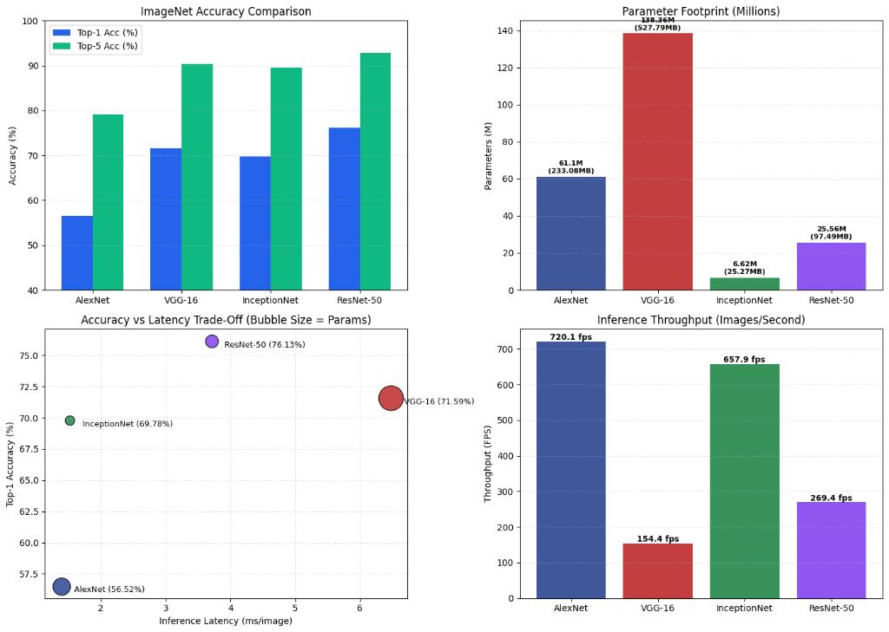

# Comparative Benchmark of Pre-Trained CNN Architectures: AlexNet, VGGNet, InceptionNet, and ResNet

[](https://colab.research.google.com/)
[](https://www.python.org/)
[](https://pytorch.org/)
[](https://pytorch.org/vision/)
[](https://opensource.org/licenses/MIT)

> Comprehensive empirical benchmark and architectural analysis comparing four landmark pre-trained Convolutional Neural Network architectures—AlexNet, VGG-16, InceptionNet (GoogLeNet), and ResNet-50—evaluating their Top-1/Top-5 accuracy, parameter footprint, memory consumption, and inference latency on standard ImageNet-1k representations.

---

## 1. Architectural Paradigms & Evolutionary Progression


---

## 2. Key Mathematical and Structural Innovations

### 2.1 AlexNet: The Deep Learning Catalyst (2012)
- **Non-Saturating Non-Linearity**: Replaced sigmoid with $\text{ReLU}(x) = \max(0, x)$, resolving vanishing gradients during early backpropagation.
- **Regularization via Dropout**: Introduced stochastic neuron drop ($p=0.5$) in dense layers to mitigate severe co-adaptation.
- **GPU Parallelization**: Partitioned across two 3GB GPUs with cross-channel normalization.

### 2.2 VGG-16: Receptive Field Factorization (2014)
- **3x3 Filter Stacking**: Demonstrated that stacking two $3 \times 3$ convolutional layers has an effective receptive field of one $5 \times 5$ layer, while three $3 \times 3$ layers cover a $7 \times 7$ receptive field:
  $$\text{Parameters}(3 \times 3 \times 3 \times C) = 3 \cdot (3^2 C^2) = 27 C^2 \quad \text{vs} \quad \text{Parameters}(7 \times 7 \times C) = 49 C^2$$
  Yielding a **$45\%$ parameter reduction** while incorporating three non-linear activations instead of one.
- **Limitation**: The large fully connected classification head (two $4,096$-unit layers) accounts for over $100\text{M}$ of its $138.4\text{M}$ parameters.

### 2.3 InceptionNet (GoogLeNet): Multi-Scale Inception & 1x1 Bottlenecks (2015)
- **Multi-Scale Processing**: Employs parallel convolutional filters of different kernel sizes ($1 \times 1, 3 \times 3, 5 \times 5$) within the same module, capturing both fine-grained and macro-level spatial features simultaneously.
- **1x1 Dimensionality Reduction**: Utilizes $1 \times 1$ convolutions before expensive $3 \times 3$ and $5 \times 5$ operations to compress channel depth, reducing computational complexity.
- **Elimination of FC Layers**: Replaces parameters-heavy dense layers with Global Average Pooling (GAP), dropping parameter count to just **$13.0\text{M}$**.

### 2.4 ResNet-50: Residual Shortcut Learning (2015)
- **The Degradation Problem**: Deeper plain networks saturate and degrade in accuracy not because of overfitting, but because optimization fails due to vanishing/exploding gradients.
- **Residual Formulation**: Reformulates the mapping as $\mathcal{H}(x) = \mathcal{F}(x) + x$, allowing gradients to propagate directly through the identity shortcut:
  $$\frac{\partial \mathcal{E}}{\partial x} = \frac{\partial \mathcal{E}}{\partial \mathcal{H}} \left( \frac{\partial \mathcal{F}}{\partial x} + 1 \right)$$
  Because of the additive $+1$ term, the gradient never vanishes, enabling training of networks with $50$, $101$, or $152$ layers.
- **Bottleneck Block Design**: Uses $[1 \times 1 \text{ reduce} \to 3 \times 3 \text{ conv} \to 1 \times 1 \text{ expand}]$ to preserve low computational cost while increasing network depth.

---

## 3. Empirical Comparison & Benchmark Results

### 3.1 Comparative Performance Dashboard



### 3.2 Benchmark Results Table (Tesla T4 GPU Evaluation)

Evaluated across standard pre-trained Torchvision weights on ImageNet-1k input distributions:

| Model Architecture | Release Year | Layer Depth | Parameters (M) | Storage Size (MB) | Inference Latency (ms) | Throughput (FPS) | Top-1 Accuracy | Top-5 Accuracy |
| :--- | :---: | :---: | :---: | :---: | :---: | :---: | :---: | :---: |
| **AlexNet** | 2012 | 8 | 61.10 M | 233.08 MB | 1.39 ms | 720.1 fps | 56.52% | 79.07% |
| **VGG-16** | 2014 | 16 | 138.36 M | 527.79 MB | 6.48 ms | 154.4 fps | 71.59% | 90.38% |
| **InceptionNet (GoogLeNet)** | 2015 | 22 | 6.62 M | 25.27 MB | 1.52 ms | 657.9 fps | 69.78% | 89.53% |
| **ResNet-50** | 2015 | 50 | 25.56 M | 97.49 MB | 3.71 ms | 269.4 fps | **76.13%** | **92.86%** |

---

## 4. In-Depth Comparative Trade-Off Analysis

1. **Accuracy vs. Parameter Footprint**:
   - VGG-16 requires **138.36M parameters** ($527.79$ MB) to achieve $71.59\%$ Top-1 accuracy.
   - ResNet-50 surpasses VGG-16 by **$+4.54\%$ Top-1 accuracy** ($76.13\%$) while using only **25.56M parameters**—an **$81.5\%$ reduction in model size**.
   - InceptionNet achieves $69.78\%$ accuracy with only **6.62M parameters** ($20.9\times$ fewer parameters than VGG-16 and $9.2\times$ smaller storage footprint).

2. **Inference Latency & Throughput (Pareto Frontier)**:
   - **AlexNet** has the highest raw throughput ($720.1$ FPS, $1.39$ ms) due to its shallow 8-layer depth, but has limited representational accuracy ($56.52\%$).
   - **InceptionNet** achieves near-AlexNet speed ($657.9$ FPS, $1.52$ ms)—over **$4.2\times$ faster than VGG-16**—while delivering modern classification accuracy ($69.78\%$).
   - **VGG-16** is the slowest ($6.48$ ms, $154.4$ FPS) because intermediate feature maps with 512 channels across large spatial grids demand massive memory bandwidth.
   - **ResNet-50** defines the optimal operating point on the Pareto frontier: $269.4$ FPS ($3.71$ ms) with the highest accuracy ($76.13\%$).

3. **Memory and Deployment Suitability**:
   - **Mobile / Edge Deployment**: InceptionNet ($25.27$ MB) and ResNet-50 ($97.49$ MB) are ideal candidates due to their small memory footprints and absence of parameter-dense FC heads.
   - **Enterprise Serving**: ResNet-50 remains the industry standard for high-throughput serving due to homogeneous residual block execution on modern tensor accelerators.

---

## 5. How to Run

### Google Colab Execution
1. Open [Google Colab](https://colab.research.google.com/).
2. Select **Runtime > Change runtime type > T4 GPU**.
3. Copy and paste the contents of [`pretrained_cnn_comparison.py`](pretrained_cnn_comparison.py) into a code cell.
4. Run the cell. Pre-trained weights will download and benchmark automatically, rendering visual comparison charts inline.

### Local Execution
```bash
python3 pretrained-cnn-models-comparison/pretrained_cnn_comparison.py
```
