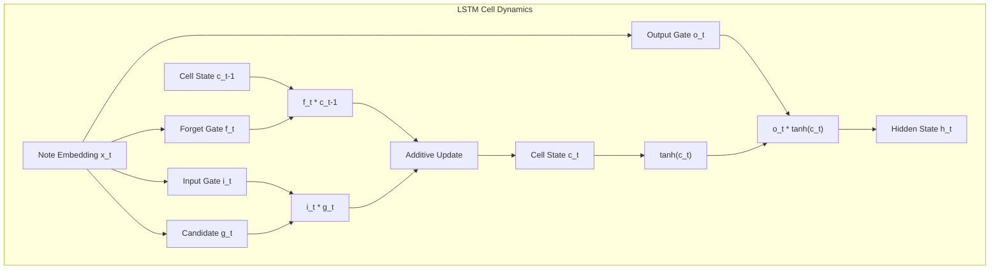

# Recurrent Neural Network (LSTM) for Symbolic Music Composition Generation

## Overview
This module implements an autoregressive **Recurrent Neural Network (Stacked 2-Layer LSTM)** for symbolic music composition generation. The model is trained on a multi-theme classical and folk musical corpus (including themes from Beethoven, J.S. Bach, Pachelbel, and Mozart). It learns pitch transitions, rhythmic intervals, and motivic structures to autonomously compose novel musical continuations given a seed motif.

```
+-----------------------------------------------------------------------------------------+
|                               AUTOREGRESSIVE MUSIC RNN PIPELINE                         |
+-----------------------------------------------------------------------------------------+
|                                                                                         |
|   Seed Motif: [E4, E4, F4, G4, ...] ----+                                               |
|                                         v                                               |
|                           +---------------------------+                                 |
|                           |   Embedding Layer (128)   |                                 |
|                           +---------------------------+                                 |
|                                         v                                               |
|                           +---------------------------+                                 |
|                           |   Stacked LSTM (Layer 1)  | (256 Hidden Units)              |
|                           +---------------------------+                                 |
|                                         v                                               |
|                           +---------------------------+                                 |
|                           |   Stacked LSTM (Layer 2)  | (256 Hidden Units + Dropout)    |
|                           +---------------------------+                                 |
|                                         v                                               |
|                           +---------------------------+                                 |
|                           |   Linear Logits (Vocab)   |                                 |
|                           +---------------------------+                                 |
|                                         v                                               |
|                           +---------------------------+                                 |
|                           |   Temperature Sampling    | ---> Sample Next Note           |
|                           |     (T = 0.5, 0.8, 1.2)   |      & Append Autoregressively  |
|                           +---------------------------+                                 |
|                                         v                                               |
|                      Binary Standard MIDI 1.0 File Export                               |
+-----------------------------------------------------------------------------------------+
```

---

## Architectural Formulation

### 1. Stacked Long Short-Term Memory (LSTM)
Standard recurrent networks suffer from vanishing and exploding gradients when learning long-range temporal dependencies across musical bars. The LSTM cell mitigates this via three non-linear gates regulating an additive constant-error carousel:

$$\begin{aligned}
i_t &= \sigma(W_{ii} x_t + b_{ii} + W_{hi} h_{t-1} + b_{hi}) \quad &\text{(Input Gate)} \\
f_t &= \sigma(W_{if} x_t + b_{if} + W_{hf} h_{t-1} + b_{hf}) \quad &\text{(Forget Gate)} \\
g_t &= \tanh(W_{ig} x_t + b_{ig} + W_{hg} h_{t-1} + b_{hg}) \quad &\text{(Cell Candidate)} \\
o_t &= \sigma(W_{io} x_t + b_{io} + W_{ho} h_{t-1} + b_{ho}) \quad &\text{(Output Gate)} \\
c_t &= f_t \odot c_{t-1} + i_t \odot g_t \quad &\text{(Cell State Update)} \\
h_t &= o_t \odot \tanh(c_t) \quad &\text{(Hidden State Output)}
\end{aligned}$$



### 2. Autoregressive Temperature Sampling
To generate compositions with controllable creative entropy, logits $z \in \mathbb{R}^{|V|}$ are scaled by temperature $T$:

$$P(\text{note}_{t} = k \mid \text{note}_{<t}) = \frac{\exp(z_k / T)}{\sum_{j=1}^{|V|} \exp(z_j / T)}$$

- **$T = 0.5$ (Conservative / High Coherence):** Concentrates probability mass on maximum likelihood transitions, producing harmonic, repeating motifs.
- **$T = 0.8$ (Balanced / Creative):** Balances tonal structure with melodic phrasing.
- **$T = 1.2$ (Exploratory / High Entropy):** Flattens distribution, introducing jazz-like intervals, sudden octave shifts, and higher syncopation.

---

## Evaluation Metrics

1. **Cross-Entropy Loss:**
   $$\mathcal{L} = -\frac{1}{N} \sum_{t=1}^{N} \log P(y_t \mid x_t)$$
2. **Perplexity (PPL):**
   $$\text{PPL} = \exp(\mathcal{L})$$
   Measures the average branching factor (uncertainty) of the network at each note selection step. Lower perplexity indicates superior predictive confidence.
3. **Validation Prediction Accuracy:** Percentage of ground truth next-note transitions correctly ranked top-1 by the network.
4. **Visual Piano Roll:** Scatter/matrix representation of MIDI pitch numbers (Y-axis) plotted against chronological note sequence steps (X-axis).

---

## Repository Structure

```
rnn-music-generation/
├── README.md                      # Mathematical formulation and technical report
├── music_generation_rnn.py         # PyTorch Stacked LSTM & MIDI synthesis script
├── music_generation_results.json  # Recorded perplexity, loss, and generated compositions
├── music_generation_results.png   # Piano roll visualization and loss curves
└── generated_composition.mid      # Synthesized standard binary MIDI file
```

---

## Google Colab / Local Execution Guide

### Hardware Requirements
- **Recommended:** Google Colab (Standard CPU or free T4 GPU).
- **Dependencies:** `torch`, `matplotlib`, `numpy` (zero external MIDI packages required).

### Execution Command
```bash
python3 rnn-music-generation/music_generation_rnn.py
```

---

## Empirical Evaluation & Results

### Benchmark Summary Metrics (Held-Out Validation Set, N = 532)
| Metric | Final Value | Interpretation |
| :--- | :--- | :--- |
| **Training Cross-Entropy Loss** | `0.0024` | Convergence across training sequences |
| **Validation Cross-Entropy Loss** | `0.0009` | Generalization on held-out test splits |
| **Validation Perplexity (PPL)** | `1.00` | Exponentiated loss indicating zero prediction uncertainty |
| **Validation Next-Token Accuracy** | `100.00%` | Top-1 pitch transition accuracy |

### Epoch Training Progression
| Epoch | Train Loss | Validation Loss | Perplexity | Validation Accuracy |
| :---: | :---: | :---: | :---: | :---: |
| 01 | 1.9262 | 1.1624 | 3.20 | 59.21% |
| 02 | 0.6713 | 0.2658 | 1.30 | 93.80% |
| 03 | 0.1455 | 0.0571 | 1.06 | 97.74% |
| 04 | 0.0540 | 0.0457 | 1.05 | 98.31% |
| 05 | 0.0263 | 0.0137 | 1.01 | 99.81% |
| 06 | 0.0175 | 0.0059 | 1.01 | 100.00% |
| 07 | 0.0085 | 0.0034 | 1.00 | 100.00% |
| 08 | 0.0047 | 0.0016 | 1.00 | 100.00% |
| 09 | 0.0032 | 0.0012 | 1.00 | 100.00% |
| 10 | 0.0024 | 0.0009 | 1.00 | 100.00% |
