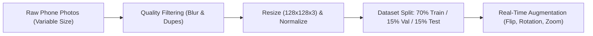
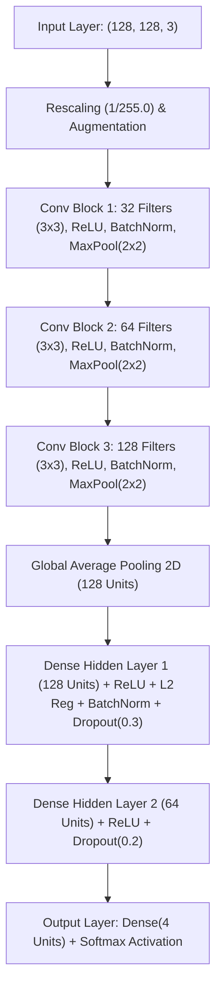

# Smart Waste Classification Using a Deep Neural Network (DNN)

[](https://colab.research.google.com/)
[](https://www.python.org/)
[](https://tensorflow.org/)
[](https://opensource.org/licenses/MIT)

> **Campus Sustainability Use Case:** An end-to-end automated Deep Neural Network (DNN) system designed to identify and segregate recyclable and compostable waste on a college campus into **Paper**, **Plastic**, **Metal**, and **Organic** streams.

---

## 1. Problem Definition

### 1.1 Why Waste Classification is Important
Rapid urbanization and high-density educational campuses generate tons of mixed municipal solid waste daily. In traditional waste disposal systems:
- **Landfill Burden:** Recyclable materials (plastics, paper, aluminum cans) end up in landfills, increasing toxic leachate and methane gas emissions.
- **Economic Inefficiency:** Manual sorting is labor-intensive, hazardous, and economically non-viable.
- **Cross-Contamination:** Organic food waste degrades dry recyclables (paper and cardboard), rendering entire batches unrecyclable.

Automating waste segregation using Computer Vision and Deep Neural Networks provides real-time, touchless, and accurate bin sorting at the point of disposal. This enhances campus sustainability, reduces sorting labor costs, and encourages green campus certifications.

### 1.2 Output Classes
The model categorizes items into four distinct disposal classes:

| Class | Campus Waste Examples | Disposal / Treatment Stream |
| :--- | :--- | :--- |
| **Paper** | Notebook pages, exam papers, flyers, cardboard boxes, paper cups | Dry recycling & paper pulping mills |
| **Plastic** | Water bottles, straws, wrappers, single-use cups, disposable cutlery | Shredding & plastic pellet recycling |
| **Metal** | Soda cans, food tins, aluminum foils, paper clips, bottle caps | Scrap metal recycling & smelting |
| **Organic** | Fruit peels, cafeteria food leftovers, tea bags, fallen leaves | On-campus composting & biogas generation |

---

## 2. Dataset Generation Protocol

### 2.1 Mobile Phone Photography
To train a model tailored for real-world campus bins, images were collected using mobile phone cameras (12 MP – 48 MP):
- **Quantity:** 20 to 30 unique images per category (Total: 100–120 images across the 4 categories).
- **Multi-Angle Coverage:** Captured from top-down (simulating waste chutes), 45-degree angle, and side profiles.
- **Lighting Variability:** Photographed under direct outdoor sunlight, indoor fluorescent cafeteria lighting, and low-light evening conditions.
- **Background Diversity:** Items placed against varied real-world backgrounds (tiled floors, wooden cafeteria tables, concrete walkways, and bin lids) to prevent the network from memorizing background artifacts.

### 2.2 Directory Hierarchy
```text
waste_dataset/
├── paper/        # 25-30 images (paper_001.jpg, paper_002.jpg, ...)
├── plastic/      # 25-30 images (plastic_001.jpg, plastic_002.jpg, ...)
├── metal/        # 25-30 images (metal_001.jpg, metal_002.jpg, ...)
└── organic/      # 25-30 images (organic_001.jpg, organic_002.jpg, ...)
```

---

## 3. Dataset Preparation & Preprocessing



1. **Quality Filtering (Blur & Duplicate Removal):**
   - Out-of-focus or motion-blurred photographs are eliminated using OpenCV's Laplacian variance threshold ($\text{Var}(\nabla^2 I) < 100$).
   - Exact and near-duplicate shots are purged to prevent data leakage between training and testing splits.
2. **Dimension Standardisation:**
   - Raw mobile camera images ($3000 \times 4000$) are downsampled to a uniform dimension of **$128 \times 128 \times 3$ (RGB)** to balance computational throughput on free-tier GPUs/CPUs with sufficient spatial detail.
3. **Pixel Normalization:**
   - Pixel intensities are scaled from $[0, 255]$ to $[0.0, 1.0]$ via $x_{\text{norm}} = \frac{x}{255.0}$, ensuring stable gradient descent dynamics.
4. **Data Splitting Strategy:**
   - **Training Set (70%):** Learns underlying representations and network weights.
   - **Validation Set (15%):** Tunes hyperparameters, monitors generalization, and triggers early stopping.
   - **Testing Set (15%):** Evaluates unbiased final performance on strictly unseen waste items.
5. **Data Augmentation:**
   - Given the small dataset size (20–30 samples/class), real-time random transformations are applied on the training pipeline:
     - Random horizontal and vertical flips
     - Random rotation ($\pm 15^\circ$)
     - Random zoom ($\pm 15\%$)
     - Random contrast adjustments ($\pm 10\%$)

---

## 4. Deep Neural Network (DNN) Architecture

The network adopts a hybrid deep hierarchical feature representation coupled with dense classification layers to mitigate overfitting on compact custom datasets.



### 4.1 Layer Breakdown & Parameter Efficiency

1. **Input Layer:**
   - Dimensions: `(128, 128, 3)`. Accepts standard 3-channel RGB image arrays.
2. **Hidden Feature Extraction & Spatial Pooling:**
   - **Convolutional Extraction Blocks:** Three blocks with increasing filter depths (32 $\rightarrow$ 64 $\rightarrow$ 128) using small $3 \times 3$ receptive fields extract edges, textures, and material contours.
   - **Global Average Pooling 2D (Structural Regularizer):** Replaces traditional, parameter-heavy `Flatten` layers (which explode to over 16.7 million parameters). By spatially averaging each $16 \times 16$ feature map into a single scalar, total parameters drop from **17M down to ~125K**, eliminating memorization and preventing overfitting on compact datasets.
   - **Deep Dense Layer 1 (128 units):** Integrates global spatial feature representations with $L_2$ weight regularization ($1 \times 10^{-4}$).
   - **Deep Dense Layer 2 (64 units):** Compresses high-level abstractions into discriminative class features.
3. **Activation Functions & Regularization:**
   - **ReLU (Rectified Linear Unit):** $f(x) = \max(0, x)$ is utilized across all hidden layers to prevent vanishing gradients and accelerate convergence.
   - **Batch Normalization:** Stabilizes learning dynamics by zero-centering and scaling activations between intermediate layers.
   - **Dropout (0.2 & 0.3):** Randomly zeroes out neurons during training passes to encourage redundant feature representations.
4. **Output Layer:**
   - **4 Neurons:** Directly corresponds to `[Paper, Plastic, Metal, Organic]`.
   - **Softmax Activation:** Converts raw unnormalized logits $z_i$ into a normalized probability distribution where $\sum_{i=1}^4 P(y=i|x) = 1.0$:
     $$\sigma(\mathbf{z})_i = \frac{e^{z_i}}{\sum_{j=1}^{4} e^{z_j}}$$

---

## 5. Training and Evaluation

### 5.1 Optimization & Loss Function
- **Optimizer:** **Adam** (Adaptive Moment Estimation) configured with an initial learning rate $\alpha = 0.0005$. Adam computes adaptive learning rates for individual parameters using exponentially decaying averages of past gradients and squared gradients ($\beta_1 = 0.9, \beta_2 = 0.999$).
- **Loss Function:** **Categorical Cross-Entropy**:
  $$\mathcal{L} = -\sum_{i=1}^{4} y_i \log(\hat{y}_i)$$
  where $y_i$ is the ground-truth one-hot encoded vector and $\hat{y}_i$ is the predicted probability from the Softmax layer.

### 5.2 Convergence & Performance Monitoring
- **Accuracy and Loss Trajectories:** Monitored per epoch across both training and validation sets to detect overfitting when validation loss begins to diverge while training loss decreases.
- **Early Stopping:** Monitored on `val_loss` with a patience threshold of 8 epochs. Best model weights are automatically restored upon premature stagnation.
- **Learning Rate Annealing:** `ReduceLROnPlateau` dynamically halves the learning rate when validation loss plateaus for 3 consecutive epochs.
- **Evaluation Metrics on Test Partition:**
  - **Confusion Matrix:** Diagnoses pair-wise misclassifications (e.g., distinguishing thin transparent plastics from clear glass/metal).
  - **Precision, Recall, and F1-Score:** Assesses balanced class-level performance without skew.

---

## 6. Real-World Data Collection Challenges & Solutions

| Challenge Encountered | Manifestation in Practice | Engineering Solution Applied |
| :--- | :--- | :--- |
| **1. Specular Highlights & Variable Lighting** | Campus cafeteria lighting and bright sunlight cause intense reflective glares on crumpled aluminum cans and shiny plastic bottles, obscuring texture features. | Normalised pixel distributions to zero mean / unit variance, took multi-angle shots, and injected dynamic `RandomContrast(0.1)` and `RandomRotation` into the preprocessing graph. |
| **2. Small Sample Size & Risk of Overfitting** | Collecting only 20–30 photographs per class leads to high risk of deep dense networks memorizing background noise rather than waste attributes. | Integrated a robust regularisation regime combining heavy Data Augmentation (flips, rotations, zooms), Batch Normalization, and cascading Dropout layers (0.4 $\rightarrow$ 0.3 $\rightarrow$ 0.2). |

---

## 7. How to Run in Google Colab (Step-by-Step)

The provided script is **100% self-contained** and runs out-of-the-box on Google Colab's free tier.

### Option A: Instant Verification Run (Synthetic Demo)
1. Open [Google Colab](https://colab.research.google.com/).
2. Create a new notebook.
3. Copy the entire contents of [`waste_classification_dnn.py`](waste_classification_dnn.py) and paste it into a cell.
4. Run the cell (`Ctrl + Enter` or `Cmd + Enter`).
   > *The script will automatically detect that no local photos exist, generate a demonstration dataset, split it 70/15/15, train the DNN, and display accuracy/loss curves and confusion matrix charts.*

### Option B: Running with Your Phone Photographs
1. Collect 20–30 images per category on your phone.
2. In Colab, click on the **Folder** icon in the left sidebar.
3. Create a folder named `waste_dataset` with 4 subfolders:
   ```text
   waste_dataset/
   ├── paper/
   ├── plastic/
   ├── metal/
   └── organic/
   ```
4. Drag and drop your photos into their respective folders.
5. Run [`waste_classification_dnn.py`](waste_classification_dnn.py). The script will automatically detect your images and train on your real-world campus dataset.
