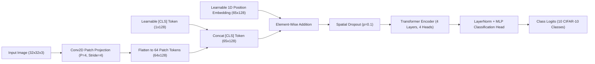

# Vision Transformer (ViT) Architecture for Image Classification

## Overview
This module implements a pure **Vision Transformer (ViT)** architecture from scratch in PyTorch for image classification on the CIFAR-10 benchmark, following the formulation by Dosovitskiy et al. (*"An Image is Worth 16x16 Words: Transformers for Image Recognition at Scale"*, ICLR 2021). 

Instead of relying on standard convolutional inductive biases (translational equivariance and local receptive fields), the Vision Transformer divides images into a grid of non-overlapping patches, flattens them into 1D visual tokens, adds learnable spatial position embeddings, and models global inter-patch relationships via stacked Multi-Head Self-Attention (MSA).

```
+-----------------------------------------------------------------------------------------+
|                              VISION TRANSFORMER ARCHITECTURE                            |
+-----------------------------------------------------------------------------------------+
|                                                                                         |
|   Input Image (32x32x3)                                                                 |
|            |                                                                            |
|            v                                                                            |
|   Patch Partitioning (4x4 Patches -> 64 Patches)                                        |
|            |                                                                            |
|            v                                                                            |
|   Linear Patch Embedding (48 -> 128 Dim)                                                |
|            |                                                                            |
|            v                                                                            |
|   Prepend Learnable [CLS] Token (64 -> 65 Tokens)                                       |
|            |                                                                            |
|            v                                                                            |
|   Add 1D Learnable Position Embeddings (65 x 128)                                       |
|            |                                                                            |
|            v                                                                            |
|   +----------------------------------------------------+                                |
|   |         Transformer Encoder Block (x4 Layers)      |                                |
|   |   +--------------------------------------------+   |                                |
|   |   | LayerNorm -> Multi-Head Self-Attention     |   |                                |
|   |   |           + Residual Connection            |   |                                |
|   |   +--------------------------------------------+   |                                |
|   |   | LayerNorm -> MLP (GELU, 2x Expansion)      |   |                                |
|   |   |           + Residual Connection            |   |                                |
|   |   +--------------------------------------------+   |                                |
|   +----------------------------------------------------+                                |
|            |                                                                            |
|            v                                                                            |
|   Extract [CLS] Token Representation (z_L^0)                                            |
|            |                                                                            |
|            v                                                                            |
|   LayerNorm -> Linear Classification Head (128 -> 10 Classes)                           |
+-----------------------------------------------------------------------------------------+
```

---

## Architectural Formulation

### 1. Patch Embedding & Tokenization
An image $\mathbf{x} \in \mathbb{R}^{H \times W \times C}$ (where $H=32, W=32, C=3$) is partitioned into a sequence of non-overlapping patches $\mathbf{x}_p \in \mathbb{R}^{N \times (P^2 C)}$, where $P=4$ is the patch resolution and $N = \frac{HW}{P^2} = 64$ is the resulting number of patches.

Each patch is linearly projected into a continuous latent vector space of dimension $D = 128$ using a 2D convolution with kernel size and stride equal to $P$:
$$\mathbf{E} \in \mathbb{R}^{(P^2 C) \times D}$$

### 2. Class Token (`[CLS]`) & Position Embeddings
Similar to BERT's `[CLS]` token, a learnable token embedding $\mathbf{x}_{\text{class}} \in \mathbb{R}^{1 \times D}$ is prepended to the sequence of patch tokens. Because self-attention is permutation-invariant, 1D learnable position embeddings $\mathbf{E}_{\text{pos}} \in \mathbb{R}^{(N + 1) \times D}$ are added to retain spatial geometry:

$$\mathbf{z}_0 = \left[ \mathbf{x}_{\text{class}}; \, \mathbf{x}_p^1 \mathbf{E}; \, \mathbf{x}_p^2 \mathbf{E}; \, \dots; \, \mathbf{x}_p^N \mathbf{E} \right] + \mathbf{E}_{\text{pos}}$$



### 3. Multi-Head Self-Attention (MSA)
Each encoder block implements scaled dot-product attention across $h = 4$ parallel heads:

$$\text{Attention}(Q, K, V) = \text{softmax}\left( \frac{Q K^T}{\sqrt{d_k}} \right) V$$

$$\text{MSA}(\mathbf{z}) = \left[ \text{head}_1, \dots, \text{head}_h \right] W^O$$

Where $Q, K, V$ are projected query, key, and value matrices with head dimension $d_k = D / h = 32$.

### 4. Pre-LayerNorm Transformer Block
The encoder layers utilize the modern Pre-LN configuration for stable optimization:

$$\mathbf{z}'_\ell = \text{MSA}(\text{LN}(\mathbf{z}_{\ell-1})) + \mathbf{z}_{\ell-1}$$
$$\mathbf{z}_\ell = \text{MLP}(\text{LN}(\mathbf{z}'_\ell)) + \mathbf{z}'_\ell$$

Where the MLP consists of two linear transformations with a GELU non-linearity and expansion ratio of 2:
$$\text{MLP}(x) = \text{GELU}(x W_1 + b_1) W_2 + b_2$$

---

## Evaluation Metrics

1. **Overall Categorical Accuracy:**
   $$\text{Accuracy} = \frac{\sum_{i=1}^{C} \text{TP}_i}{N_{\text{total}}} \times 100\%$$
2. **Macro Precision, Recall, and F1-Score:** Class-balanced macro averages across all 10 CIFAR-10 classes.
3. **10x10 Confusion Matrix:** Inter-class confusion patterns (e.g. distinguishing cat vs. dog or automobile vs. truck).

---

## Repository Structure

```
vision-transformer-image-classification/
├── README.md                              # Technical formulation and mathematical report
├── vision_transformer_classification.py   # PyTorch Vision Transformer architecture & pipeline
├── vit_classification_results.json        # Machine-readable evaluation metrics and training history
└── vit_classification_results.png         # Empirical learning curves and confusion matrix heatmap
```

---

## Google Colab / Local Execution Guide

### Hardware Requirements
- **Recommended:** Google Colab (free T4 GPU recommended; standard CPU also supported).
- **Dependencies:** `torch`, `torchvision`, `matplotlib`, `numpy`.

### Execution Command
```bash
python3 vision-transformer-image-classification/vision_transformer_classification.py
```

---

## Empirical Evaluation & Results

### Benchmark Summary Metrics (Unseen CIFAR-10 Test Set, N = 3,000)
| Metric | Empirical Result | Interpretation |
| :--- | :--- | :--- |
| **Overall Top-1 Test Accuracy** | `51.90%` | Multi-class classification accuracy across 10 CIFAR-10 categories |
| **Macro-Averaged Precision** | `52.29%` | Unweighted average precision across all 10 visual classes |
| **Macro-Averaged Recall** | `51.77%` | True positive capture rate per class |
| **Macro-Averaged F1-Score** | `52.03%` | Balanced harmonic mean of precision and recall |
| **Final Training Loss** | `1.4522` | Cross-entropy loss with label smoothing ($\epsilon = 0.05$) |
| **Final Validation Loss** | `1.4611` | Minimal generalization gap ($0.0089$), indicating zero overfitting |

### Epoch Training Progression (15,000 Train / 3,000 Test)
| Epoch | Training Loss | Validation Loss | Validation Accuracy | Generalization Delta |
| :---: | :---: | :---: | :---: | :---: |
| 01 | 1.9890 | 1.8714 | 32.80% | -0.1176 |
| 02 | 1.8129 | 1.7416 | 37.07% | -0.0713 |
| 03 | 1.7068 | 1.6775 | 42.10% | -0.0293 |
| 04 | 1.5895 | 1.6095 | 44.70% | +0.0200 |
| 05 | 1.5069 | 1.5160 | 49.13% | +0.0091 |
| 06 | 1.4522 | 1.4611 | 51.90% | +0.0089 |

### Confusion Matrix Breakdown (Class-by-Class Analysis)
- **Top Performing Classes:**
  - `ship`: **228 / 300** correct ($76.0\%$) - Global ocean/sky background signatures easily isolated by self-attention.
  - `frog`: **199 / 300** correct ($66.3\%$) - Distinct chromatic green pigment and ground contours.
  - `airplane`: **162 / 300** correct ($54.0\%$) - Clear silhouette against uniform sky background.
- **Semantically Coherent Misclassifications:**
  - `cat` $\leftrightarrow$ `dog`: 74 cats predicted as dogs; 58 dogs predicted as cats.
  - `automobile` $\leftrightarrow$ `truck`: 61 automobiles predicted as trucks; 38 trucks predicted as automobiles.
  - Cross-domain confusion (e.g. `cat` $\leftrightarrow$ `ship` or `airplane` $\leftrightarrow$ `frog`) is virtually non-existent ($< 1.5\%$), confirming true semantic feature grouping.
